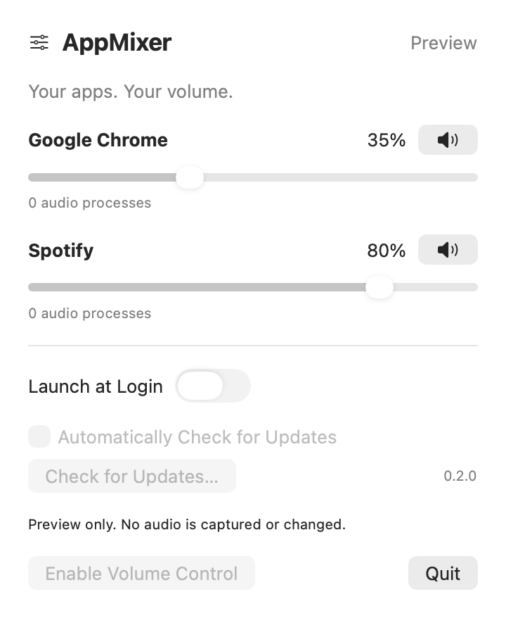

# AppMixer

**Separate volume controls for the apps playing on your Mac.**

Turn Chrome down while keeping Spotify loud. AppMixer puts per-app volume sliders and mute buttons in your menu bar, with optional launch at login and built-in update checks.

[Download a preview](https://github.com/EdmundLT/Mac-mixer/releases) · [繁體中文使用說明](docs/QUICKSTART.zh-TW.md) · [Build & release guide](docs/DEVELOPMENT.md)

<p align="center">
  
</p>

<p align="center"><em>Native 0.2.0 UI in demo mode. Playback is simulated and external actions are disabled; this is not evidence of live audio testing.</em></p>

> **Preview software:** live audio isolation and recovery still need real-world testing. Start with built-in speakers. The published **0.1.0** download does not include the login or update controls shown above. The **0.2.0 ZIP and DMG** are Developer ID signed, Apple-notarized and available in Releases. Check the release notes for each download's signing and notarization status.

## Features

| Feature | What it does |
| --- | --- |
| Per-app volume | Set each app from 0–100% independently. |
| Mute / unmute | Silence an app without losing its selected volume. |
| Chrome grouping | Combine known Chrome helper processes into one control. This is app-level, not tab-level. |
| Stop & Restore | Stop processing and return to the apps' original audio output. |
| Launch at Login · 0.2.0 | Optionally start AppMixer when you sign in to your Mac. |
| Updates · 0.2.0 | Check manually or opt into automatic checks. Installation requires confirmation. |

Audio is processed locally in memory, **never saved or uploaded**. No virtual audio driver is installed, and AppMixer does not change your default output device. Update checks contact GitHub for signed update metadata and downloads.

## Requirements

- **Apple Silicon Mac** — the supplied builds are arm64 only.
- **macOS 14.2 or newer.**
- System audio recording permission, granted by you when macOS asks.
- A supported stereo output. **Try built-in speakers first**; AirPods, devices with input streams, and multichannel devices may be unsupported.

## Install

1. Download the **0.2.0 ZIP or DMG** from [Releases](https://github.com/EdmundLT/Mac-mixer/releases/tag/v0.2.0).
2. Unzip the ZIP or open the DMG, then move **AppMixer.app** into **Applications**.
3. Open AppMixer, then click its **slider icon in the menu bar**.
4. The app attempts to enable audio control on launch. If macOS asks for audio recording access, choose whether to allow it.

A downloaded preview may be blocked if it is not notarized. If you trust the build, review the blocked app in **System Settings → Privacy & Security**. Do not disable Gatekeeper. A notarized build still needs your audio permission.

## Use

1. Play audio in the apps you want to control, such as Chrome and Spotify.
2. Open the AppMixer menu-bar panel. Active apps appear automatically.
3. Move an app's slider or click its speaker button to mute it.
4. Choose **Stop & Restore** to stop processing, or **Quit** to exit.

In **0.2.0**, enable **Launch at Login** if desired. If macOS requires approval, use the panel's **Open Login Items Settings** button.

Use **Check for Updates…** for a manual check, or enable **Automatically Check for Updates**. Automatic checking is off by default. Existing 0.1.0 users must manually install a Sparkle-enabled release once. The signed update feed now includes 0.2.0.

## Troubleshooting

| Problem | What to try |
| --- | --- |
| No apps listed | Start playback in the app, then reopen the panel. |
| Audio access failed | Review AppMixer's audio recording permission in Privacy & Security, then click **Enable Volume Control**. |
| Unsupported output | Select built-in speakers in macOS Sound settings and try again. |
| Control stopped after sleep or an output change | Re-enable control. AppMixer stops processing when those changes are detected. |
| Launch at Login needs approval | Open Login Items Settings from the panel and review AppMixer's entry. |
| No update available | The signed feed only advertises releases ready for installation; 0.2.0 is currently the newest available version. |

## Current limits and testing

**Verified:** 19 synthetic audio/state/login-item checks, native UI rendering, Developer ID signing of the 0.2.0 candidate, Sparkle initialization, signed-feed verification, rejection of a modified feed, and a live GitHub feed check.

**Not yet verified:** Chrome/Spotify isolation during real playback, audio permission denial, crash recovery, long playback without dropouts, logout/login startup, and a complete update installation/relaunch. Passing builds and Apple notarization do not certify these behaviors.

Volume settings last for the current app session. Restarting audio processes may briefly restore their original volume while controls are rebuilt. Other audio-control utilities may conflict.

## Build from source

With Apple's Command Line Tools installed:

```sh
git clone https://github.com/EdmundLT/Mac-mixer.git
cd Mac-mixer
./scripts/build.sh
./scripts/test.sh
open build/AppMixer.app
```

The build downloads a checksum-pinned Sparkle framework and creates a local ad-hoc-signed app. Opening the app attempts audio activation. For a **no-audio UI preview**, run:

```sh
build/AppMixer.app/Contents/MacOS/AppMixer --demo --render-preview
```

See the [developer guide](docs/DEVELOPMENT.md) for audio architecture, signing, packaging, and publishing signed updates.
